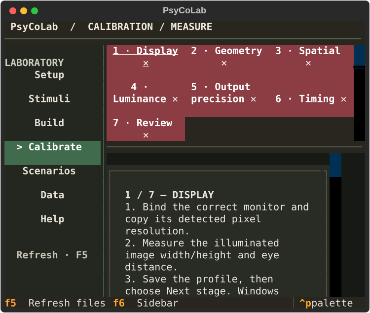
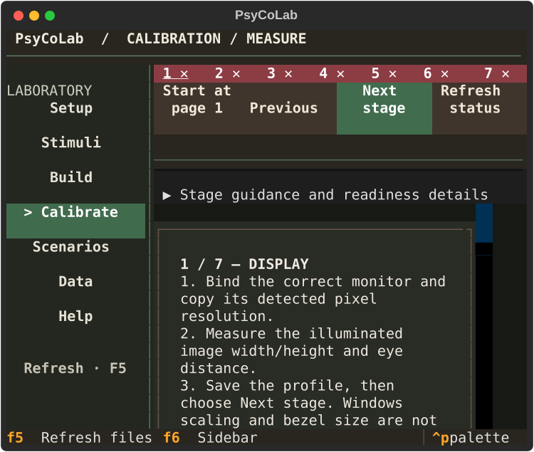
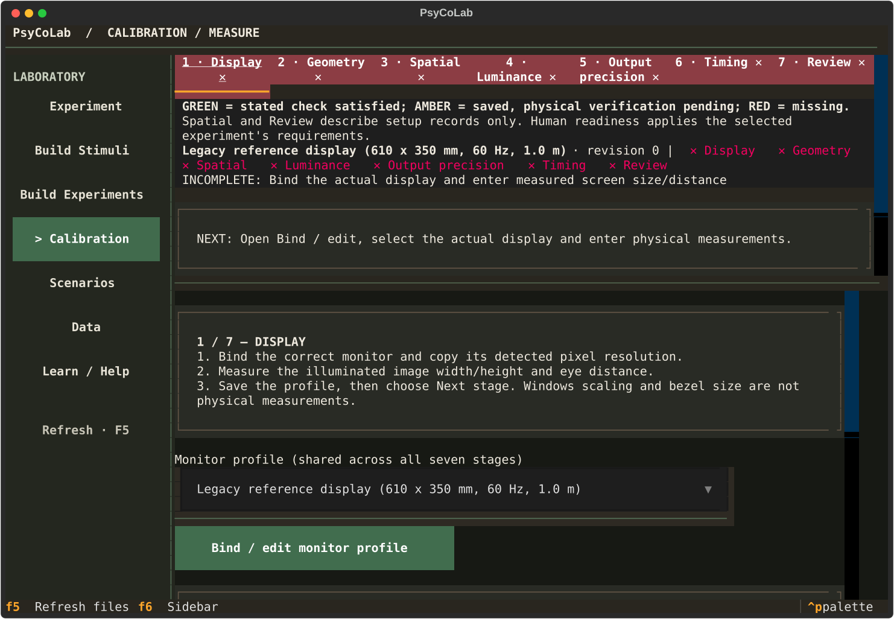
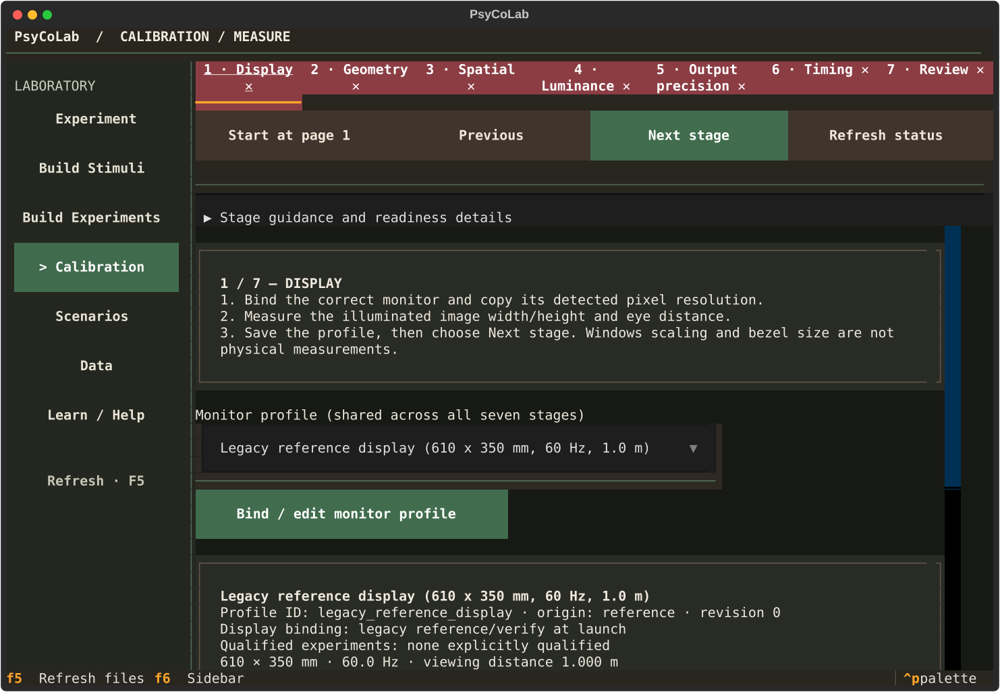
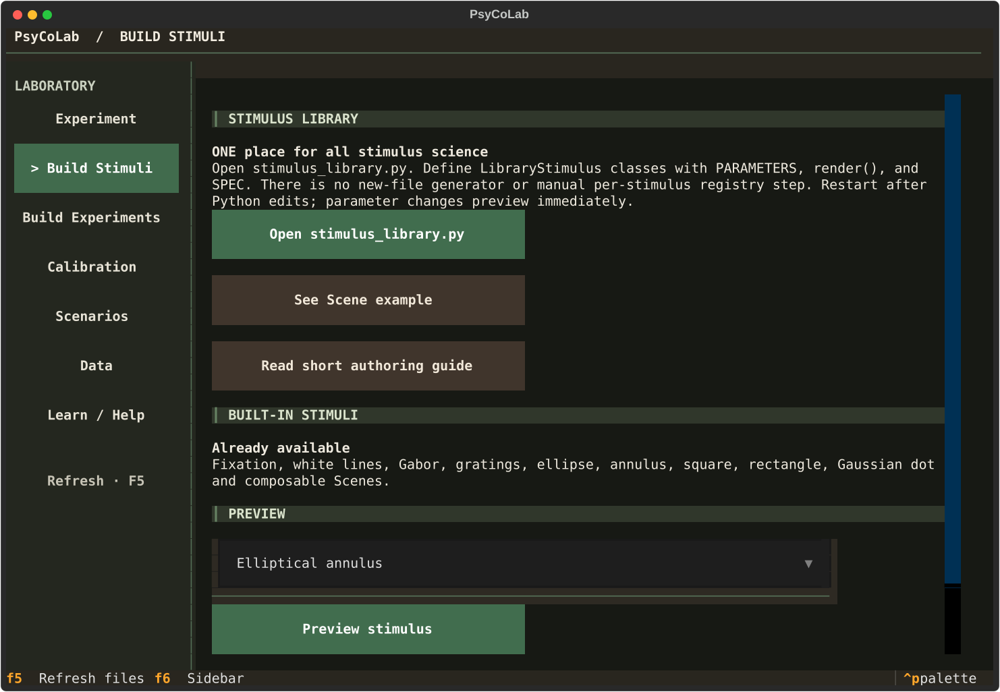
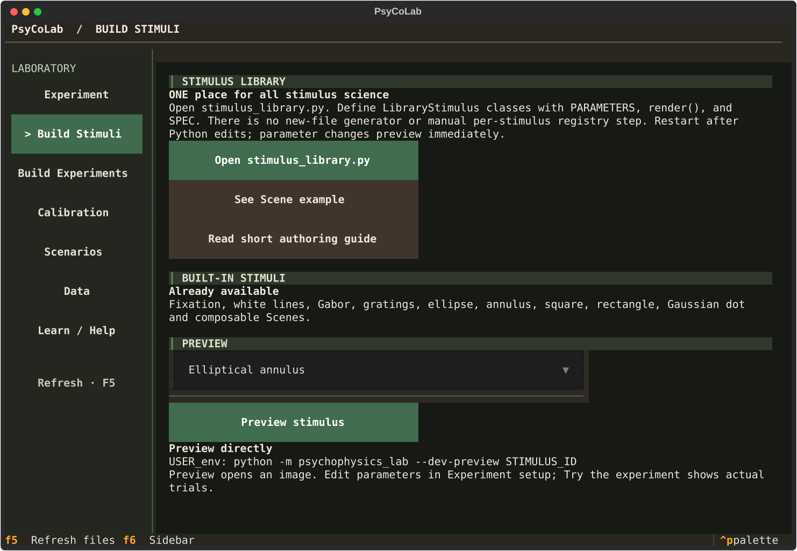

# Console layout refinement — local verification

This change refines the existing Coffee & Forest console. It does not change experiment definitions, calibration requirements, acquisition, participant rendering, simulations, or stored data.

## Problems found and changes

| Area | Finding and result |
| --- | --- |
| Shared styling | The Slate palette still loaded ahead of Coffee & Forest. Removed that stylesheet and retained its useful Setup structure in the existing Coffee & Forest module. Removed obsolete compact calibration grids. No additional stylesheet was introduced. |
| Setup | Preserved the wide form/context columns and compact stacking; reduced common workspace padding and capped form controls at 64 columns. The data path can use the available width. |
| Calibration | The old narrow stage grid consumed the fixed area and hid its actions. Seven numbered status buttons now fit one compact row; full names and state explanations remain in tooltips and stage content. Guidance/readiness details expand separately. Previous, Next, Start and Refresh remain visible above scrolling measurement forms. |
| Build Stimuli / Help | Removed surplus action spacing and section-title spacing. Short pages fit at 120×40; content remains scrollable when the terminal is smaller. |
| Build Experiments / Data / Scenarios | Shared bounded controls and vertically grouped body actions apply consistently. Existing long descriptions/forms scroll. |
| Configure / Review | Header actions share available width instead of overflowing. Preserved the hidden Stimulus conditions group, complete Review matrix, source editing/reload workflow, response-guidance checkbox and researcher override entry. |
| Nested editors | Inspected display selection, stimulus values, JSON preset, source viewers, display profile, physical verification, qualification, luminance data and virtual-observer options. Existing Back/Save routes and draft values are covered by tests. |

## Rendered evidence

These SVGs are exported from the actual locally instantiated Textual application with `run_test` / `save_screenshot`, using isolated configuration and data folders. They are application-rendered captures, not native Windows desktop screenshots or design mockups.

| Page | Before | After |
| --- | --- | --- |
| Calibration, 60×24 |  |  |
| Calibration, 120×40 |  |  |
| Build Stimuli, 120×40 |  |  |

Main-page captures and all seven calibration stages were inspected. Additional rendered nested screens and main routes were inspected at 60×24, 80×24, 120×40 and 160×55. Long scientific forms still require scrolling on small terminals. The source viewer may require horizontal scrolling for long lines.

## Local validation

Python 3.11, repository `.venv`, focused suite:

```text
python -m pytest -q tests/test_coffee_forest_layout.py tests/test_slate_precision_layout.py tests/test_laboratory_console.py tests/test_calibration_review_completion.py tests/test_review_file_navigation.py tests/test_response_guidance_toggle.py
```

53 passed. A writable explicit `--basetemp` and `-p no:cacheprovider` were used locally. One existing local extension warning reports that `new_probe_vertical_line_stimulus` changed since its last successful test and was not loaded. An initial run without an explicit temporary directory encountered Windows permissions errors; it was rerun with a writable directory.

Added regression coverage checks every calibration stage and toolbar bounds at all four sizes, ensures measurement space remains available, expands the readiness details, and resizes the mounted screen to restore full stage labels. Existing tests cover F6/sidebar keyboard navigation, nested return routes, draft preservation, Review source-file editing/reload and response guidance. The complete scientific suite was not rerun for this layout-only change.

An interactive terminal launch was exercised again after the final edits; the Setup screen rendered and the app exited normally with Ctrl+Q. A maximized native Windows terminal screenshot could not be obtained through the available window surface, so native-window visual acceptance remains unverified. The exported captures and local tests are not a substitute for that remaining check.

The pre-existing local change in `experiments/contrast_sensitivity.py` was verified byte-for-byte unchanged and excluded from the commit.

