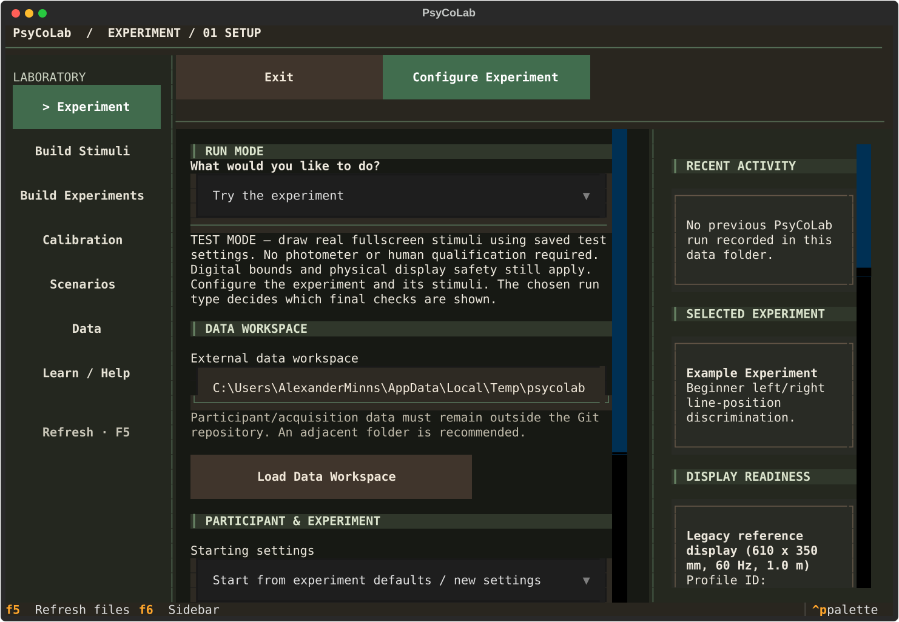
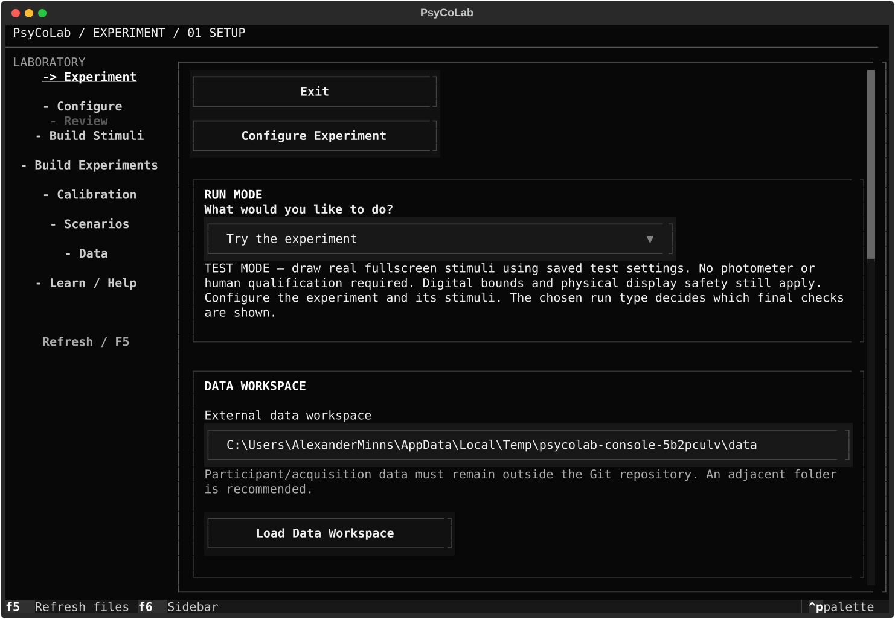
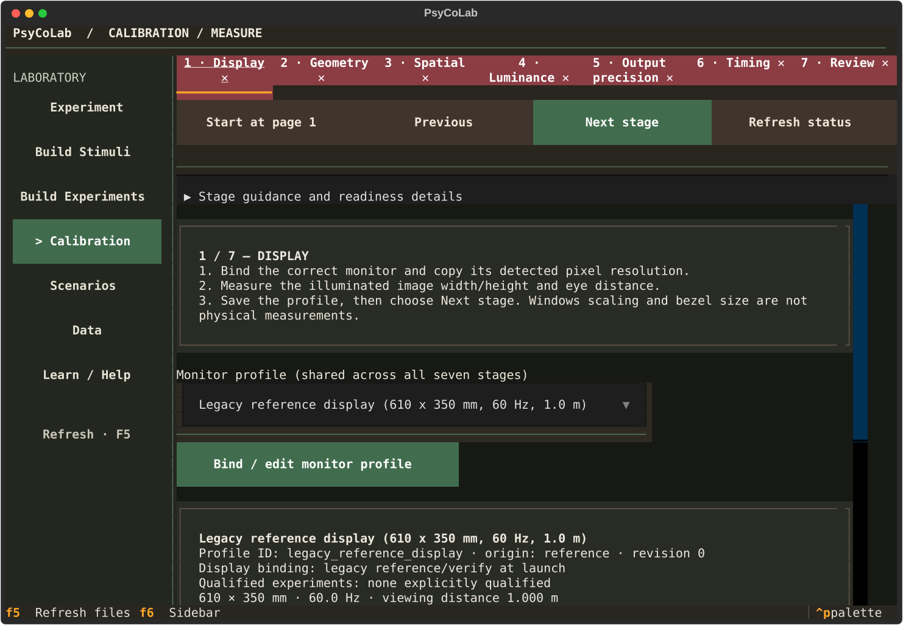
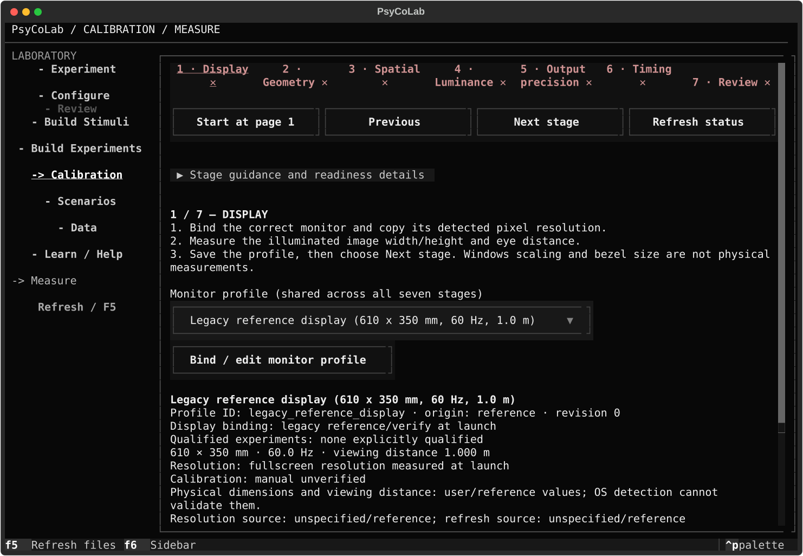
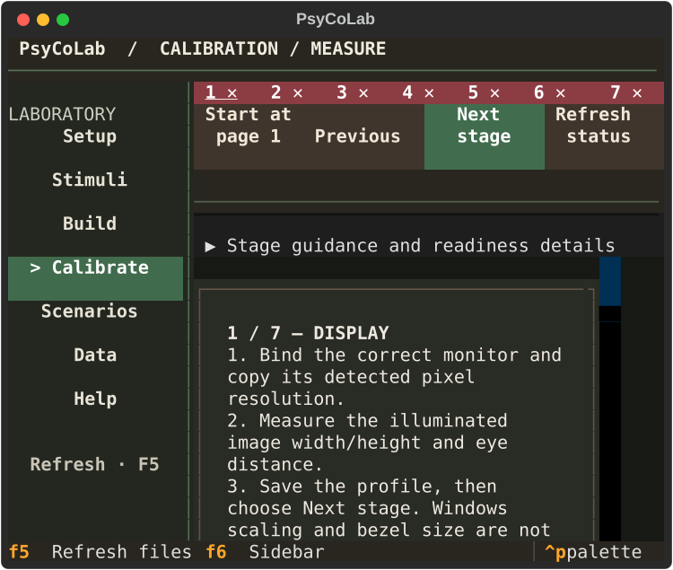
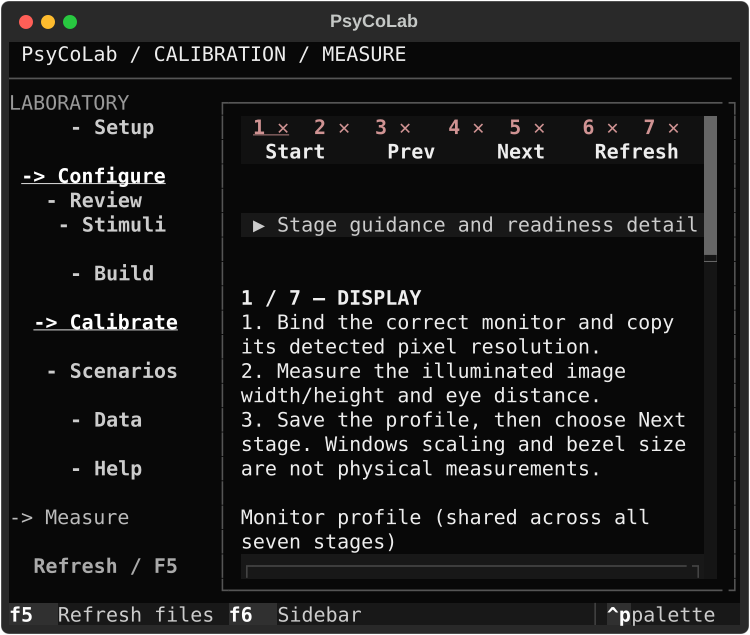
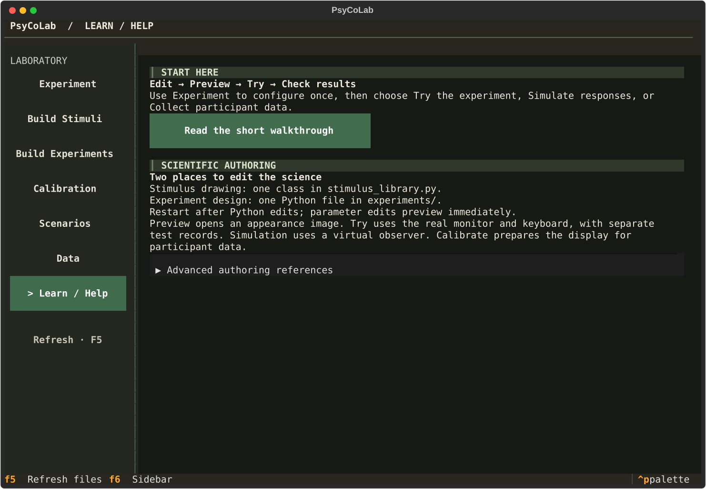
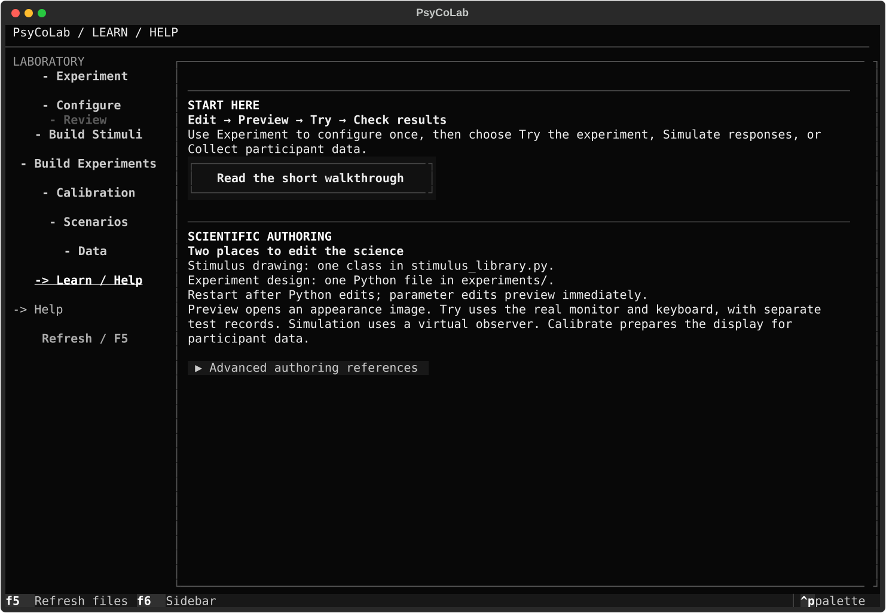

# Fixed monochrome laboratory console

PsyCoLab now uses one application shell for every researcher page. At a fixed terminal size, navigation changes only the content inside the workspace. This replaces the Coffee & Forest and Slate visual direction.

## Original layout problems

The original local captures showed page-specific fixed action areas, a separate Setup context column, and several overlapping style layers. Calibration reserved a substantial upper area before its measurements. Short and long pages used different content boundaries. The replacement uses one shared frame and scroll owner.

## Shell and measured geometry

`ui/console.py` owns the grid, navigation, workspace and control styles. `ConsoleScreen.compose` wraps each page's `compose_content` in the same workspace; Setup uses the same composition helper. Header and footer are created once per screen by this shared system, rather than repeated in page composition.

Coordinates are zero-based terminal cells. Regions below are `(x, y, width, height)` and are asserted directly for all main routes and nested editors, including after terminal resize.

| Terminal | Header | Sidebar | Main panel | Reserved vertical rail | Footer |
| --- | --- | --- | --- | --- | --- |
| 60 × 24 | 0,0,60,2 | 0,2,17,21 | 17,2,43,21 | 57,3,1,19 | 0,23,60,1 |
| 80 × 24 | 0,0,80,2 | 0,2,17,21 | 17,2,63,21 | 77,3,1,19 | 0,23,80,1 |
| 120 × 40 | 0,0,120,2 | 0,2,23,37 | 23,2,97,37 | 117,3,1,35 | 0,39,120,1 |
| 160 × 55 | 0,0,160,2 | 0,2,23,52 | 23,2,137,52 | 157,3,1,50 | 0,54,160,1 |

The sidebar breakpoint is 100 columns. The header is always two rows and the footer one row. The main panel fills the remaining grid cell. Its single-cell scrollbar has a stable gutter, so short pages retain exactly the same content width when the thumb disappears. Border and padding are included in the panel region; the rail lies immediately inside its right padding/border.

The workspace is the principal scroll owner. Former page scroll containers are content-sized groups with scrolling disabled. Scientific tables and text editors retain deliberate internal scrolling. The sidebar can scroll if its hierarchy exceeds the available height, without moving its boundaries.

## Navigation and page changes

- Sidebar markers: `>` means hovered or keyboard-focused, `->` means active, and `-` means inactive. The active entry also remains underlined/bold when focus moves. Configure and Review are persistent indented routes, keeping the major sidebar rows stationary. The contextual label has its own reserved bottom row. Nested pages show a contextual child label; parameters remain in the workspace.
- Setup: one vertical content flow, with aligned Run Mode, Data Workspace, and Participant & Experiment groups. Recent activity, experiment information and display readiness follow in the same workspace. No separate right column remains.
- Configure and Review: existing controls and source editing are retained in the shared panel. The complete scientific parameter/condition matrix, reload behavior, response-guidance toggle and researcher override remain available. The redundant Stimulus conditions group stays hidden while its fields are retained.
- Calibration: all seven stages stay available, with compact numbered indicators at narrow sizes and full tooltips. Detailed guidance expands inside the workspace. All measurement fields and actions scroll within the same fixed panel. Calibration toolbar labels shorten at compact sizes.
- Build Stimuli, Build Experiments, Data, Help and Scenarios: shared controls, left alignment, monochrome sections and one workspace rail. Short content remains at the top; the panel does not shrink.
- Display/profile, verification, qualification, luminance, source, JSON, stimulus-value and virtual-observer pages: same shell; existing return/save handlers preserved. Long source paths wrap, and editors retain internal scrolling.

Ordinary controls are capped at 64 columns and body buttons at 34, shrinking with the viewport. The palette is near-black, white and grey. Calibration status retains semantic red/amber/green alongside text and symbols. Modal confirmations keep their existing workflows and overlay the current shell; they inherit the monochrome application theme.

## Removed legacy presentation

Removed `coffee_forest.py`, the old app-level style block, per-page Header/Footer declarations and the obsolete `_nav_bar` placeholder. Slate was already removed on main. Layout and visual styles now live together in `console.py`; the app registers one monochrome theme. Former palette-specific tests were renamed to `test_console_content.py` and `test_console_controls.py`, retaining workflow coverage and updating obsolete two-column expectations.

## Visual evidence

Before captures were taken from the clean local main checkout (`2c8e040`, including merged PRs 83 and 84), before editing. After captures use the same local Windows installation and Python environment. These are Textual application-rendered SVG exports, not mockups or native desktop screenshots.

| Page | Before | After |
| --- | --- | --- |
| Setup |  |  |
| Calibration |  |  |
| Compact Calibration |  |  |
| Help |  |  |

The rendered main pages, all seven calibration stages, and 42 additional nested/main screen states were inspected. Screens covered 60×24, 80×24, 120×40 and 160×55; regression checks also resize a mounted app to 140×48.

## Validation and limits

Final combined acceptance suite: **126 passed, 1 warning in 225.76 seconds**. This included all console tests plus calibration completion, Review file navigation, response guidance, researcher override, teaching workflows and local implementation checks. The intentional hardware-failure test logs a crash report as expected and passes.

The broader UI-related run completed with 858 passes and 19 failures. Seven failures were tests assuming fixed page actions; these were updated to focus the action and wait for scrolling before clicking, and all seven pass. The new nested-navigation failure was fixed and its regression passes. The remaining 11 failures were reproduced on an unchanged local snapshot of main (`2c8e040`): audit diagnostics, calibration-guide routing, qualification-message expectations (two tests), pixel-pitch rendering, researcher calculations (two sizes), finite-step metadata (three experiments), and opt-in scenario navigation. Those existing issues are outside this presentation-only PR. No scientific assertions were relaxed.

The final sidebar geometry/navigation rerun passed all 14 tests. The run emits an existing warning about a locally changed, untested contributed experiment, which remains excluded by the registry. `git diff --check` passed.

New tests assert the complete region coordinates, content viewport and scrollbar rail rather than widget existence. They exercise Page Down, short-page overflow, dropdown expansion, all seven calibration stages, hover/focus markers, F6, Configure/Review routing and nested returns with retained draft values. Existing tests cover calibration validation, Review source-file editing/reload, response guidance, acquisition override and simulation workflows.

No experiment, stimulus, acquisition, timing, calibration-calculation, adaptive-method or data-schema source is changed. Only researcher UI composition, presentation and navigation are modified.

Native Windows limitation: the desktop capture inventory does not expose the terminal window, including after the user opened it and brought it forward. Application-rendered exports were inspected, but maximized native-window visual acceptance cannot be claimed. No user terminal was closed; inspection processes created by the agent were closed.
