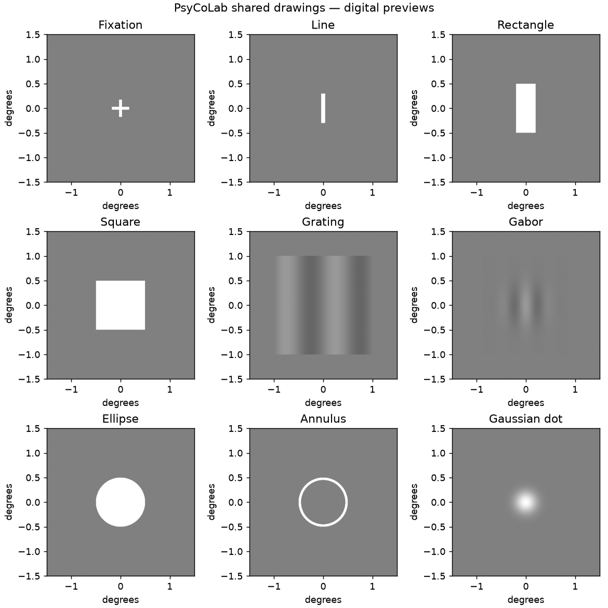
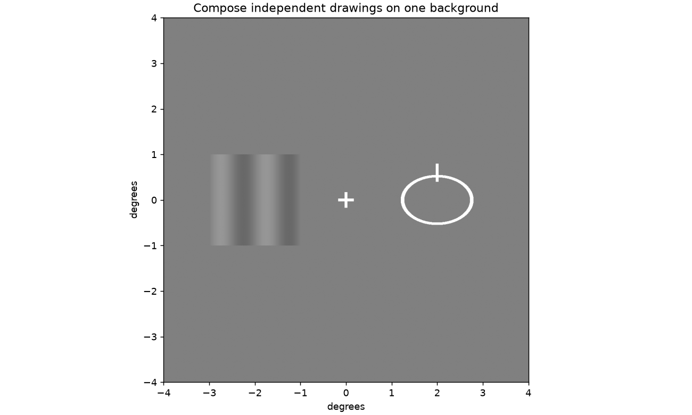

# Shared stimulus library and legacy experiment reconstruction

## Status and source authority

The researcher-facing drawing library is now
`src/psychophysics_lab/stimulus_library.py`. Simple functions return immutable
drawings; `Scene` composes them; separate procedures build `TrialTimeline`
actions and call `RunContext`. The existing registered modules remain supported.
Nothing in `Events/stimuliC.py`, the CSF acquisition procedure, saved participant
data, or researcher-created experiments is replaced.

**The three new registered procedures are DEVELOPMENT reconstructions, not
human-ready replacements.** The TUI shows them, and ordinary synthetic runs use
the shared pipeline, but human preflight and direct procedure calls block
acquisition. This is a substantive migration limitation, not a calibration flag
that can be dismissed. Finishing a virtual replay does not establish parity.

Sources inspected:

- [Original stimuliC.py](https://github.com/aminns123/psychophysics_experiments_git/blob/1c3177594e00f0b26fa361238db0f4db5de403fa/stimuliC.py)
- [Original Ellipse2D_experiment.py](https://github.com/aminns123/psychophysics_experiments_git/blob/1c3177594e00f0b26fa361238db0f4db5de403fa/Experiments/Flanker_Experiment/Ellipse2D_experiment.py)
- [Original functionUSE.py](https://github.com/aminns123/psychophysics_experiments_git/blob/1c3177594e00f0b26fa361238db0f4db5de403fa/Functions/functionUSE.py)
- Local main `c222b4711f70d90938c94c3d6e7efff2f5bdd874`, especially
  `Events/stimuliC.py`, `Experiments/contrast_sensitivity_function.py`, the
  public action API, and the existing CSF fixtures.

The complete original class inventory, including the TWO definitions named
`Rectangle`, is in [LEGACY_STIMULUS_INVENTORY.md](LEGACY_STIMULUS_INVENTORY.md).
Dynamic, audio, file-writing and bit-depth classes were inspected and classified;
they were not blindly turned into static drawing functions.

## What can be reused now





| Function | Meaning / units | Important boundary |
|---|---|---|
| `fixation` | Plus sign, full arm length and stroke width in degrees | New reusable primitive, not the old Gaussian dot |
| `line` | Filled rectangle; 0 degrees is vertical | Legacy line angle 90 corresponds to 0 here |
| `rectangle`, `square` | Filled shapes in degrees | Not the old ambiguous Rectangle shaders/wireframe class |
| `gaussian_dot` | Gaussian alpha against Scene background | Four-sigma cutoff; not legacy 8-bit texture parity |
| `grating` | Square aperture, mean + amplitude × sine/cosine | Frequency is cycles/degree; carrier orientation does not rotate aperture |
| `gabor` | Gaussian envelope × sinusoid | Does not replace dynamic CSF, RGB/box output, or anisotropic shader envelopes |
| `ellipse` | Filled ellipse with two semi-axes in degrees | No automatic conversion of ambiguous historical axes |
| `annulus` | Elliptical ring; inner ellipse is scaled by `inner_ratio` | Legacy normalized width `w` maps to `sqrt(1-w)` |

All values must be finite. Intensities must be in [0,1]. Grating mean ± amplitude
must fit that range: no hidden clipping. Scene recipes use a closed data schema,
not executable strings. Placement copies do not mutate the original drawing.
Scene layers compose on one background; no opaque per-object patch erases
another object's surroundings. Aperture containment is conservative and may
require a larger scene than a tightly fitted unrotated primitive.

The registered `composed_scene` adapter converts a Scene recipe to the existing
raster backend. Scene-contained frequencies are included in the monitor's
Nyquist check. The backend remains static grayscale/8-bit and uses the existing
monitor geometry path. No optical or timing equivalence is claimed.

## Experiment families and source-established sequences

### CSF / flanker_Response

Continue to select **`contrast_sensitivity`**. The new
`experiments/_internal/flanker_response.py` exposes that exact existing specification; it
does not register a duplicate or change the renderer. `flanker_Response` in the
original file is also a response-handler name for line-probe tasks; treating it
as a separate, unambiguous grating experiment would be wrong.

Current CSF action-state fixtures and `python -m simulations.csf_actions` remain
the development parity route. See [CSF_ACTION_MIGRATION.md](CSF_ACTION_MIGRATION.md)
for its outstanding renderer, RNG, audio and hardware boundaries.

### Indirect flanker and matched baseline

Entry points: `experiments/indirect_flanker.py` and `experiments/base_flanker.py`.
Both call one shared protocol with the same conditions, seed, target schedule,
responses and adaptive histories. The baseline omits the grating; this corresponds
to the source's contrast-zero grating on a matching uniform background, apart
from unproven raster/rounding details.

Source chronology is fixation 250 ms → fixation interval 250 ms → grating +
line probe + fixation 250 ms → fixation delay 500 ms → indefinite response.
An extra leading fixation of 250 ms is preserved on the first trial. Up is
alternative 0; Down is alternative 1. The trial accepts UP/DOWN; the handler's
LSHIFT alias is not actually in that trial's accepted key list.

Literal source: the grating is centred at **x = -3°**, despite its right-hand
comment. Width is 5°, non-box amplitude is `.018/2`, and nominal frequency label
1 maps to `31.5/(2*pi*5)` cycles/degree under the translated degree grid. It is
not silently treated as 31.5 cpd. The source's position array derives from
`linspace(.25,.5,4)`. Probe y is ±0.6°. The local sign scheduler preserves the
source algorithm; a seeded local generator is used for reproducibility, without
claiming the same global Python/NumPy RNG consumption as the old program.

### Ellipse 2AFC (two temporal intervals)

Entry point: `experiments/ellipse_2d.py`. **User-selected interpretation: preserve
literal source geometry**, including ellipse centred on fixation. The source
fixation is 200 pixels above screen centre; the ellipse and fixation share that
centre. The source semi-axis `.5` multiplies a 500-pixel quad, producing 250-pixel
semi-axes, despite the parameter comment calling it degrees. The migration
converts those pixel quantities with the selected monitor geometry. A missing
profile resolution must be supplied explicitly for a synthetic reference run.

The source line is 1 × 3 pixels and uses a live positive condition x; its draw()
overrides the signed constructor x. Its y constructor mistakenly subtracts a
degree-valued half-length from pixel coordinates. This odd tiny offset is
retained and identified in the resolved geometry rather than silently repaired.
The ring uses background + .6 and normalized squared-radius width .02.

Chronology: fixation 250 → fixation interval 250 → decision 250 → first interval
250 → fixation interval 250 → second interval 250 → fixation delay 500 → response.
The probe interval and mask interval are shuffled. Both contain the ellipse;
only one contains the probe. Keys 1/2 report first/second. The old logger stores
the *last* interval's A/B value; inspection of `EllispeResponse` confirms that
this is consistent with 1 = first, 2 = second for the shuffled two intervals.

**Unresolved source defects requiring explicit development choices:**

- `condition_list`/condition mapping flags have no assignment for
  `Ellipse_2D_Experiment`. No historical condition list is asserted. Its default
  config is `[]`, and running it requires a supplied positive position array.
- `expALL_decsison` is assigned only for the radius variants and is undefined
  for this branch. A virtual run must explicitly select
  `fixation_only_development`; that is a declared reconstruction choice, not an
  established historical display.
- The Gaussian fixation texture, alpha quantization, screen-coordinate
  rasterization, and ellipse shader have not been pixel-compared. Conversion
  to degrees preserves axis geometry but is not shader equivalence.

## Adaptive evidence and limits

The new `legacy_flanker_log` algorithm implements the source's **condRule=2**
numeric rule, separately from CSF. It preserves per-condition histories,
zero-based nDW=2 meaning three correct responses, initial `.2` log decrements,
later `.7393*.19` decrements, `.19` increments, trial-point 9/reversal-point 1
switching, presented-value reversal counting (including its short-history
quirk), and eight-decimal stored intensity rounding. The initial phase does
**not** simply end at the first incorrect response as in current CSF.

`tests/fixtures/legacy_flanker/numeric.json` captures **128 numeric updates**
from the original `conditions()` and its numeric helpers, including interleaved
conditions, initial changes, holds and reversals. The reference capture script
parses only an explicit allowlist of functions from the pinned source, verifies
its normalized SHA-256, and never imports the old interactive program, opens
participant files, or executes its shaders. Reproduce with:

```text
python scripts/capture_flanker_reference.py --source PATH_TO_ORIGINAL_functionUSE.py --output NEW_capture.json
```

Compare the new file to the checked-in fixture. This evidence covers numeric
updates, not the entire historical experiment lifecycle.

The development stop policy retires a condition immediately after a response
reaches 10 reversals or 101 trials. The source checks the previous condition on
the following trial, removes it after selection, and waits over three more
passes on the final condition. That delayed termination and stale-selection
behaviour are **not reproduced**. Fixed trial ceilings use 10 × number of
conditions by default, as the source queue does. Canonical status distinguishes
`completed` from `max_trials_reached`; it never pads uncollected responses.

The source can step above digital intensity 1. The pure numeric adapter retains
that result for comparison. A subsequent raster presentation rejects it and
preserves accepted records; it does not silently clamp or call it a valid
stimulus. Starting contrast 1 is preserved in source defaults; the example
virtual runs explicitly use .1 to exercise ordinary trajectories.

## Reproducible development runs and previews

From the repository's USER_env or `.venv` Python, use **new output folders outside
the repository**, never a participant-data directory. The 1920×1080 dimensions
and ellipse positions below are explicit example selections, not recovered
historical measurements.

```text
python -m examples.shared_stimuli --output C:\PsyCoLab_Development\scene_preview_01
python -m simulations.legacy_families --experiment indirect_flanker --width-px 1920 --height-px 1080 --output C:\PsyCoLab_Development\indirect_01
python -m simulations.legacy_families --experiment base_flanker --width-px 1920 --height-px 1080 --output C:\PsyCoLab_Development\base_01
python -m simulations.legacy_families --experiment ellipse_2d --width-px 1920 --height-px 1080 --conditions .25 .5 --decision-scene fixation_only_development --output C:\PsyCoLab_Development\ellipse_01
python -m pytest -q tests/test_stimulus_scenes.py tests/test_legacy_flanker_migration.py tests/test_csf_action_parity.py
```

Each virtual run uses the normal monitor/configuration registry, synthetic
participant marker, canonical `trials.tsv`, adaptive snapshots, action traces,
source hashes, manifest and saved-run validator. Raw scientific state and
per-trial resolved Scene recipes are in `trial_actions.json`. Canonical rows
include presented/next intensities and contrasts, condition identity, within-
condition trial index, step, reversal and completion. Existing participant
records are never migrated or rewritten.

## Remaining work before acquisition migration

Resolve ellipse conditions and decision content scientifically; establish
pixel/alpha and calibration parity; implement and qualify interval/feedback
audio (legacy 450/550 Hz interval and 1000/300 Hz feedback, with blocking Beep
timing); review startup/welcome/end screens; compare RNG consumption and the
delayed stopping policy; qualify response/held-key behaviour and abort paths on
hardware; measure photon timing and input latency. The new timeline omits the
old 5-second title, key-gated welcome and final instruction screens. The current
fixed `TrialTimeline` also cannot represent post-response timed audio.

Do not enable these development procedures for humans by merely removing the
block message. Preserve the source evidence and review the protocol choices.
