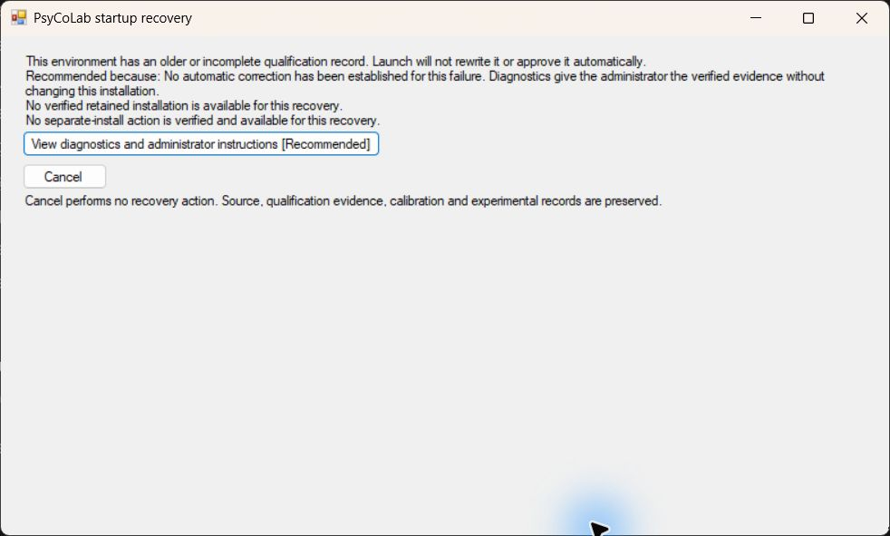

# Windows launch and guided startup recovery

`run_psycolab.bat` is the normal batch entry point for a source installation.
It checks that checkout's own qualified `.venv` and opens PsyCoLab without a
choice dialog when the checks pass. Installation and updates remain deliberate
actions in the [existing guided Windows setup](WINDOWS_GUIDED_INSTALLATION.md).
An ordinary launch never invokes setup, pip, Conda, a branch switch or editable
metadata repair. `run_user_env.bat` remains a separate development terminal tool.

## Maintainer Git checkout on a new PC

The qualified laboratory profile is an exact Conda interpreter build. Installing
Python 3.11 from python.org does not satisfy that profile. A source-compiled
recovery host has no installation package, so it cannot create a qualified
environment on a fresh computer; diagnostics and Cancel alone cannot complete
first setup.

For source maintenance, use the explicit development setup:

1. Install 64-bit CPython 3.11. A python.org installation is supported here.
2. Double-click `setup_psycolab_dev.bat` in a Git checkout without a `.venv`.
   It downloads the project's declared development dependencies into `.venv-dev`
   and validates imports, dependency compatibility and editable source identity.
3. Double-click `run_psycolab.bat` to open the normal TUI. Repeat launches only
   check the development environment; they do not run pip install or write setup
   records. If dependencies or editable metadata change, rerun the explicit setup.

The recovery window displays this route for eligible Git checkouts. Development
setup records use a distinct filename and `mode: development`; they do not write
or substitute for laboratory qualification. The normal launcher selects
`.venv-dev` only in a Git checkout with **no `.venv` present** and no managed
installation record. A failing, legacy or damaged `.venv` never falls back to
development. Preserve it and use a separate Git checkout instead. Managed
installed snapshots continue to require their existing source seals and locked
environment checks.

This route supports source maintenance and the ordinary TUI; laboratory software
qualification and physical apparatus acceptance still require the approved
installation workflow. The existing experiment, calibration, extension trust and
data safeguards still apply.

## Before and after

| Situation | Previous source batch | This change |
| --- | --- | --- |
| Healthy repeat launch | Called provisioning/setup before opening the app | Calls the existing read-only `launcher_setup.py --check`, then opens once |
| Older `.venv` record | Setup refusal and terminal instructions/pause | Native explanation, available verified choices, diagnostics and Cancel |
| Missing own environment | Searched registered/global interpreters to bootstrap | Preserves the checkout and explains approved separate-install options |
| Source revision changes | Setup could refresh editable metadata | Environment-compatible changes pass existing checks; a mismatched identity is refused without repair |
| Nonzero application exit | Terminal pause for every error | Startup phase or conservative incident explanation; no automatic retry |

The reported legacy problem is reproducible: the previously tested laboratory
record was inspected read-only and had neither schema-2 qualification nor profile
evidence. That establishes missing evidence, **not** an incompatible interpreter
or permission to approve the old environment. The native exercise used a separate
fixture with an old record and a deliberately unusable interpreter; it never ran
that interpreter or changed the laboratory record.

## What the recovery window can offer

Exactly one available action carries **[Recommended]**, with its reason:

1. A retained installation, when it has already passed its own read-only checks.
   It is checked again on selection. The failing invocation's experiment arguments
   are not replayed. No global active-version pointer or shortcut is replaced.
2. Otherwise, **Create separate approved installation**, only when the host's
   embedded package manifest and every required artifact pass the existing
   guided-setup validation. This opens that same setup, with its existing
   separate-directory, cancellation and qualification protections.
3. Otherwise, **View diagnostics and administrator instructions**. This is also
   the only recommended action after an application has started and failed.
4. **Cancel** performs no recovery action. In explicitly opened recovery for an
   already healthy installation, Cancel is recommended; normal launch is separate.

Unverified options are omitted, with a short explanation. There is no arbitrary
Python picker, automatic dependency reinstall or qualification-record editor.
This change establishes no safe in-place repair, including a shortcut rewrite.
An administrator can use the existing setup's explicit version-specific shortcut
action after checking the selected installation; startup does not guess a target.

The source-compiled host has **no embedded package inventory**, so it cannot
offer installation from nearby loose wheels or a guessed download. An administrator
must deliberately obtain/open the complete authenticated, reviewed setup package.
The separate-install recovery route is available to a packaged host only while
its own complete sealed package remains alongside it. An installed snapshot alone
does not contain all provisioning artifacts and must not advertise that route.

Retained discovery is deliberately bounded to the existing per-user default
`LocalAppData/PsyCoLab/Installations/versions` store and, for a moved-checkout
failure, the recorded original source path. Other/custom stores remain accessible
through their existing fixed-version shortcuts or Setup. Invalid, inaccessible,
incomplete or source-seal-mismatched entries are never offered as launch choices.

## Diagnosis boundaries

| Evidence | Category and safe next step |
| --- | --- |
| No/older/malformed setup record | Missing, legacy or unreadable qualification; preserve it and obtain administrator review |
| Recorded source root differs | Path changed; offer the original only if it still passes its own gate |
| Profile inventory hash or dependency specification differs | Changed profile/requirements; separate approved environment required |
| Scientific Python edit with unchanged dependency contract | May pass environment checks; **not scientific approval** or a Ready promotion |
| Missing interpreter, failed process creation, failed existing check | Missing/damaged environment or failed check; diagnostics preserve the specific evidence |
| Owned pending attempt without successful state | Interrupted setup; ordinary launch never resumes it |
| Nonzero exit during the reported application-startup phase | Startup failure; inspect the existing error/crash/fatal evidence without assuming every nonzero exit is an unhandled crash |
| Experiment/operation phase, unknown phase or no notification | Incident after launch; preserve incomplete runs, never retry acquisition |

The existing check still verifies interpreter/support binaries, full installed
inventory/core fingerprints, artifact evidence and editable identity. Packaged
installations also retain the full source seal, including refusal of added source
files. A source checkout is not frozen science: Review, provenance, calibration,
extension trust and Test → Ready/source invalidation remain authoritative.
No scientific code, recording schema or incomplete-run handling is changed here.

The application sends its existing diagnostic phase and crash-report location
over a private named Windows pipe at exit. No acquisition marker file is added.
A missing/late/malformed message becomes an unknown incident. Exit codes 0, 75
(existing refresh handoff) and 130 (cancellation) do not open recovery. Reporting
does not resume an operation. A fatal native crash may lack phase information.

## Bootstrap and independent fallback

Both batch files call `scripts/windows_startup.cmd`, which compiles the existing
`packaging/windows/GuidedSetup.cs` with Windows' .NET Framework C# compiler into
a fresh user-temporary executable. It uses no application Python or new package
manager. Compiling a temporary host adds a short startup delay. Executables and
compiler logs remain in the user's temporary directory; opening diagnostics
explicitly writes a fresh JSON report there and opens Notepad. Cancel performs
no recovery action, but does not undo those bootstrap/report artifacts.

`psycolab_recovery.bat` is an optional fallback for opening the **same** diagnosis
and recovery window without automatically launching the current application.
It is useful if application entry fails; it cannot repair a missing internal
bootstrap or broken Windows native components. A compiler failure uses a static
native message with the compiler-log location, plus console text. No PowerShell
execution-policy bypass is used. Managed machines that prohibit compilation or
temporary executables need an administrator-approved existing packaged shortcut.
Existing installed executables and their version-specific shortcuts are not
rewritten by updating this source checkout.

Reports can contain local paths and captured diagnostic output. Review/redact
them before sharing; startup never uploads them. Windows/.NET legacy path limits
or access restrictions can cause safe refusal rather than automatic correction.

## Windows evidence and acceptance limits

On the available Windows computer, the actual production WinForms recovery form
was opened through `SetupWindow.Main` against the disposable legacy fixture.
The recommended diagnostics action opened the JSON in native Notepad; Cancel
closed recovery. All five fixture files retained their original hashes and no
files were added to the fixture. This is native interaction on the previously
tested workstation, not independent researcher/workstation acceptance.

Automated Windows regressions exercise actual compiled native code, the real
batch entry point, repeated launches, Unicode/space-containing paths, category
selection, retained-source sealing, failed/cancelled setup, absent artifacts,
exit notifications and application/startup versus operation failure. The launch
fixtures use a hardware-free stand-in app/check; separate existing locked-profile
regressions verify the qualification gate. No fixture record is an approval of a
real environment. Child-failure tests verify a single invocation and no retained
launch/install action after start.

| Acceptance case | Outcome / evidence |
| --- | --- |
| Healthy repeated batch startup and arguments | PASS: actual batch/native host, stand-in app, unchanged state |
| Legacy/missing evidence, path, profile/specification, pending setup, damaged/missing interpreter | PASS: native diagnosis and fixture-byte preservation |
| Compatible versus incompatible source/dependency changes | PASS: existing read-only gate; no scientific approval inferred |
| Verified retained source versus corrupt/absent entries | PASS: recheck and full managed-source seal; no arbitrary interpreter |
| Missing approved package | PASS: install action absent, diagnostics recommended |
| Available approved package | PASS for recommendation policy; complete artifact validation reuses existing setup; a new recovery-to-install native interaction is NOT VERIFIED |
| Failed/cancelled separate setup | PASS: existing native-engine preservation regressions; no new installer implementation |
| Startup crash, operation failure and unknown child exit | PASS: real child exits, no replay or alternate-install action |
| Native legacy dialog, diagnostics and cancellation | PASS on the available workstation; screenshot above |
| Independent researcher, independent Windows PC, managed student accounts | NOT VERIFIED |

Independent workstation and ordinary-student/administrator acceptance remain
**NOT VERIFIED**. This work does not requalify approved old/new software pairs,
complete Stage 5 rollback, clear redistribution/licensing/signing gates, or certify
laboratory hardware. Existing setup qualification evidence remains separate.
