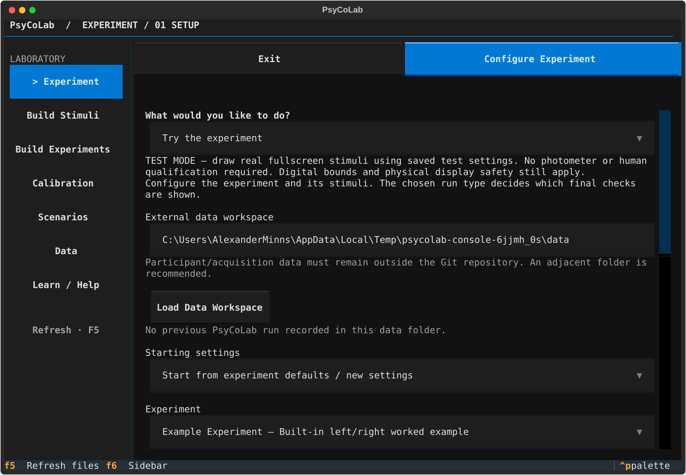
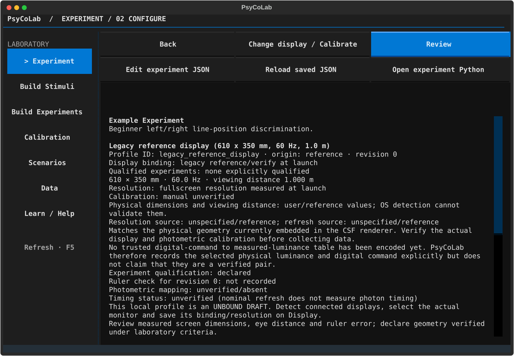
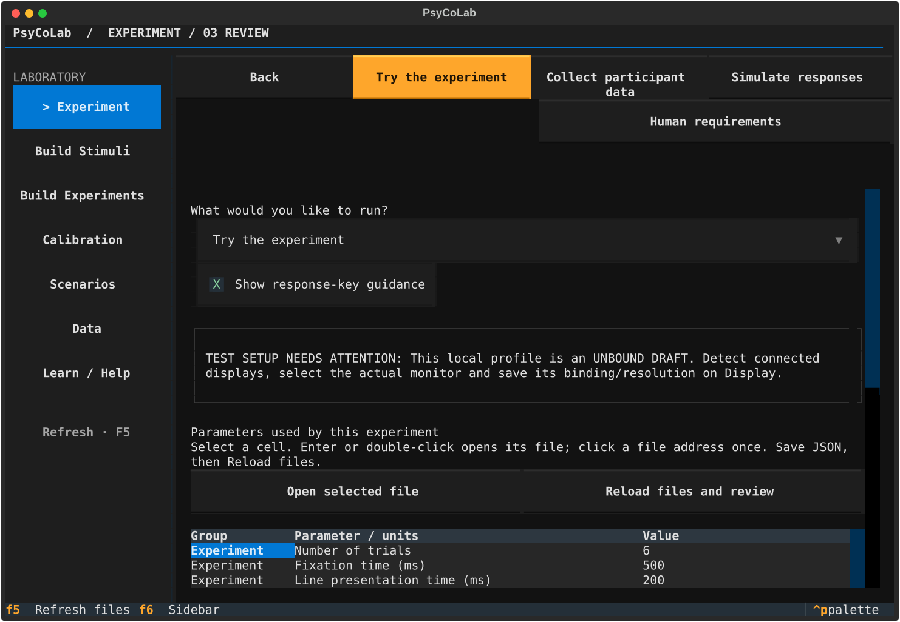
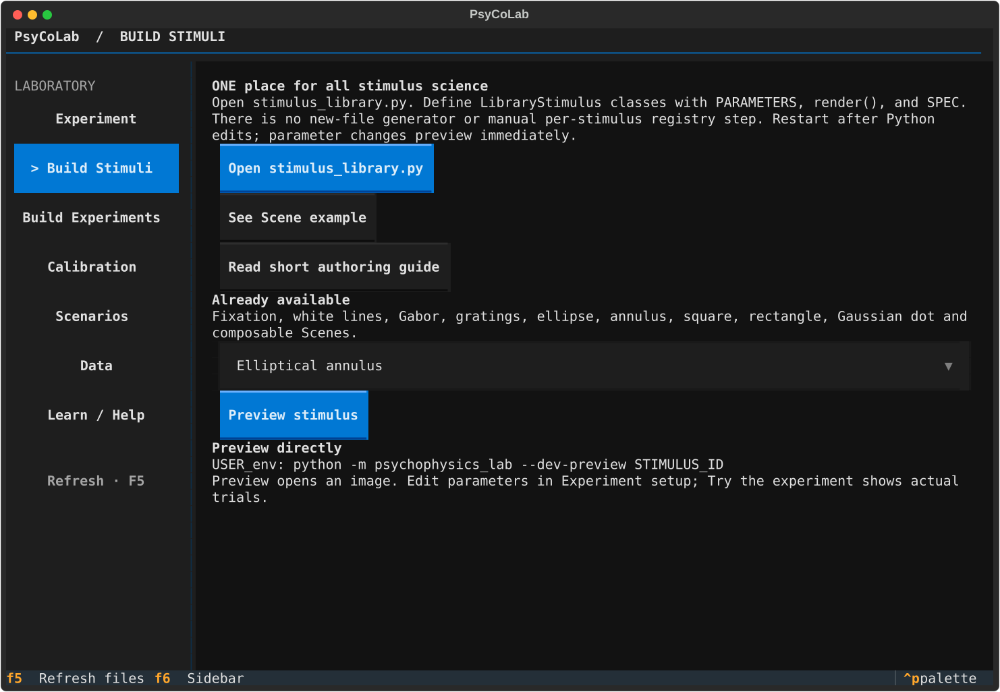
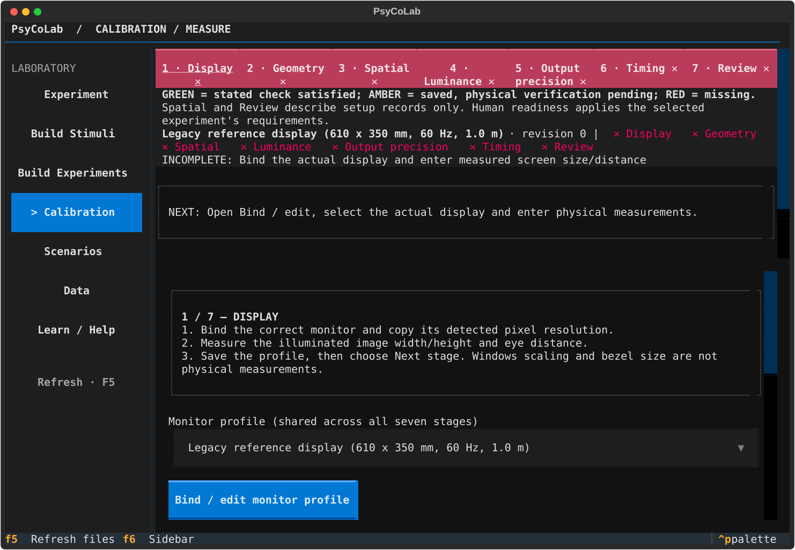
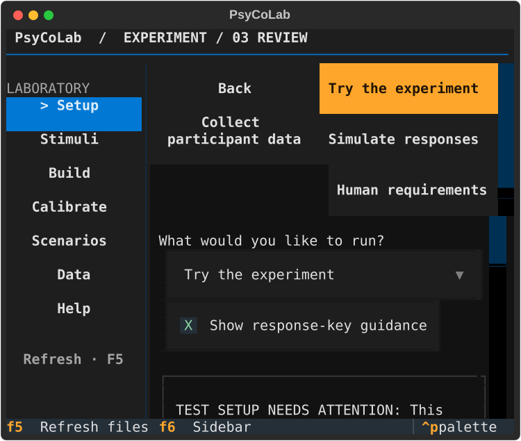
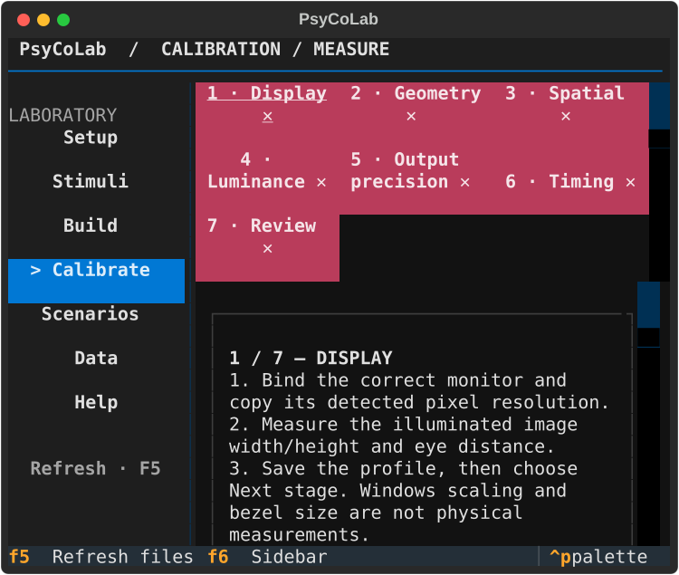

# Laboratory Control Console (Design B)

PsyCoLab now keeps laboratory navigation on the left, the current section and workflow step in a shared header, and existing forms and tables in the workspace. The sidebar calls the existing hub router and preserves its draft handling and optional Scenarios route. Participant-facing fullscreen presentation is outside this change.

## Navigation and layout

- **F6** focuses the current sidebar entry. **Tab / Shift+Tab** move focus; **Enter** activates an entry. **F5** retains the existing file-refresh behavior.
- The current section has a `>` marker and bold styling as well as color. Keyboard focus is underlined.
- The sidebar uses 23 columns normally and 17 below 100 columns. Below 32 rows, entries become shorter vertically. Very short sidebars can scroll using the normal keyboard focus behavior.
- Compact action areas use two columns. Calibration stages wrap into two rows, or three below 70 columns. Status descriptions and long forms remain scrollable.
- Existing Back/Cancel actions, calibration stage progression, input validation and file-opening actions remain in place. Calibration completion and Review launch/override controls stay at the top of their pages.
- PR #76's response-guidance checkbox remains checked by default and keeps its existing behavior. Its shorter label has the original explanation in a tooltip.

## Implementation map

| Component | Change |
| --- | --- |
| `ui/console.py` | Shared sidebar, section/header context, responsive styles and screen mounting |
| `ui/setup.py` | Replace horizontal navigation, install the root shell, add F6, arrange Review and calibration actions |
| `ui/calibration_review.py`, `ui/luminance_data.py`, `ui/profiles.py` | Use the shared screen base |
| `ui/simulations.py`, `ui/unified_run.py` | Use the shared screen base for scenario and virtual-observer pages |
| `ui/source_view.py`, `ui/stimulus_editor.py`, `ui/stimulus_parameters.py` | Keep nested editors inside the same shell |
| `tests/test_laboratory_console.py` | Navigation, resizing, keyboard, draft, bounds and nested-page regressions |
| `tests/test_local_implementation.py` | Preserve fixed-navigation tests using the new header boundary; explicitly scroll the workspace rather than the new sidebar |

The original route IDs, routing function and workflow handlers remain. Modal confirmations continue to overlay their parent page. No new dependencies are required.

## Captures

Captures use isolated demonstration configuration and data directories; they do not show participant records. These are actual Textual terminal captures, not mockups. Normal captures are 120×40 and narrow captures are 60×24.

| Setup | Configure |
| --- | --- |
|  |  |

| Review, including response guidance | Stimulus workspace |
| --- | --- |
|  |  |

| Narrow Review | Narrow calibration |
| --- | --- |
|  |  |

## Verification

Baseline: commit `d4f3a6b1940a98dd2f7a369bf9d046f42bd4d050` (main with PR #76 merged). Before editing, the selected hub, response-guidance and review-file tests passed: **17 passed**.

Final verification results are recorded in the pull request. Checks include the complete headless pytest suite, the affected UI regression group, `scripts/portability_check.py`, Python compilation and `git diff --check`.

Automated interaction and capture inspection cover all principal routes at 60×24, 80×24, 120×40 and 160×55; live terminal resizing; keyboard and mouse routing; configuration drafts and Review; display selection; profile, verification, qualification and luminance pages; source, JSON and stimulus-value editors; virtual-observer options; simulation review/adaptive editing through the existing suite; and all seven calibration stages. Long workspace content remains independently scrollable. The label/selection checks also run in a monochrome test environment.

No physical display, photometer, timing sensor, audio device or human acquisition session was used for this UI validation. Hardware measurements and participant-facing presentation require laboratory verification.

### Existing main failures

The following **12 failing cases were independently reproduced on unchanged main**, using the same local Python environment and isolated test data. They are not silently skipped, deleted or changed by this PR. Scientific repairs belong in separate work.

| Test file / case | Existing failure |
| --- | --- |
| `test_audit_regressions.py` / aborted-run diagnostics | Expected partial status, received `available` |
| `test_calibration_guide.py` / contrast link | Opens DisplayCheckScreen while the test expects ExperimentConfigScreen |
| `test_calibration_lifecycle_reliability.py` / workflow | Qualification-message regex no longer matches |
| `test_csf_thesis.py` / direct human call | Qualification-message regex no longer matches |
| `test_geometry_and_parameter_files.py` / image geometry | Rendered image differs from expected array |
| `test_researcher_workflows.py` / calculation, two sizes | Expected 0.258755, received 0.266148 |
| `test_scientific_execution_audit.py` / large steps, three experiments | Planning context lacks `overrides` |
| `test_simulation_pipeline.py` / repeatability | Timestamp differs by one second |
| `test_simulation_pipeline_visuals.py` / scenario entry | Test expects Scenarios with historical routes disabled |

The existing warning about the untested `new_probe_vertical_line_stimulus` component also appears on main. It needs its normal USER_env retest; this UI change does not alter its readiness or source.

Stimulus definitions/rendering, contrast and geometry calculations, timing, response handling, staircases, calibration policy/calculations/storage, simulation execution, data schemas/paths/exports, experiment defaults and saved configurations are untouched.
